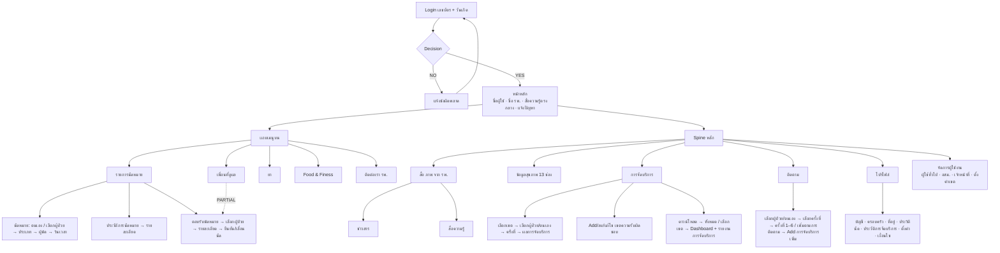
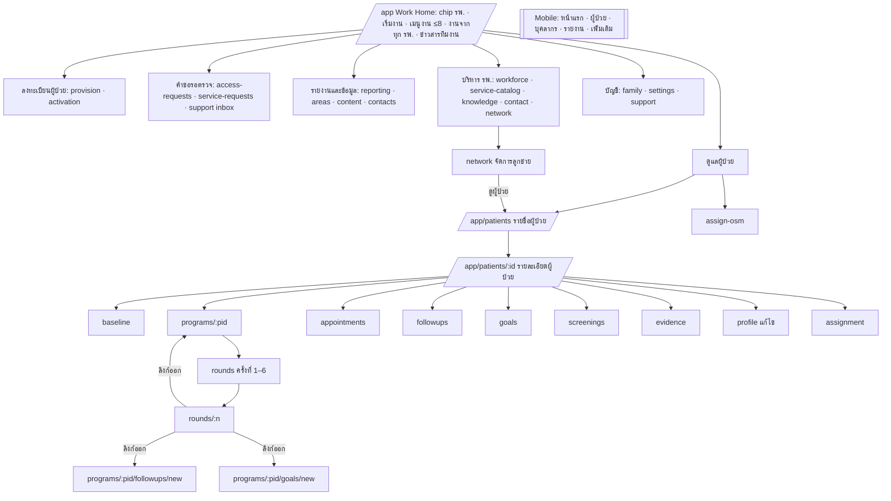
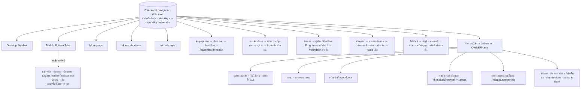
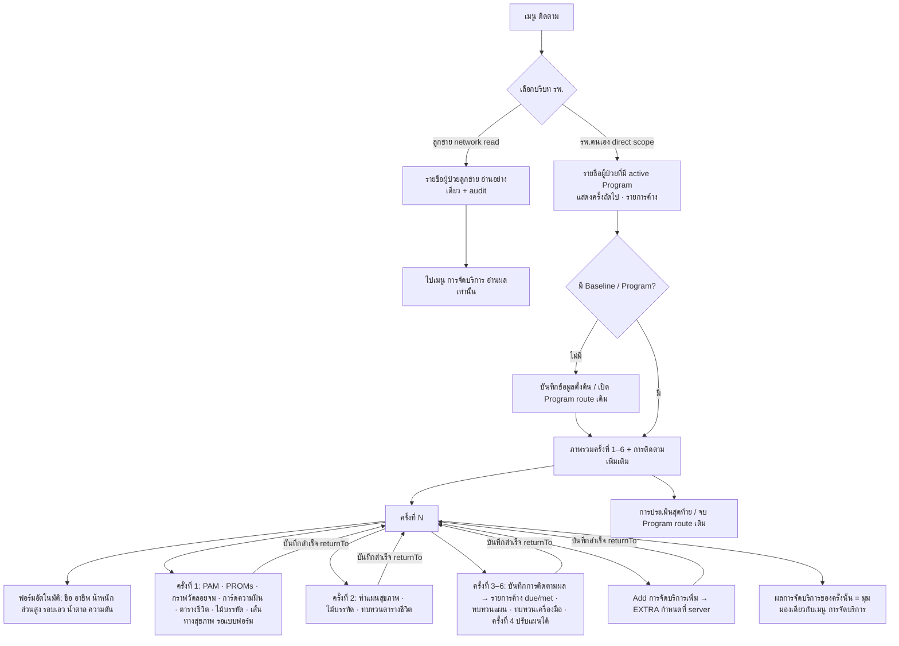

# OWNER-CANVA-01 — Canonical Canva Flow Audit & Hospital OWNER Alignment

- **ประเภท:** Audit-only (ไม่มีการแก้ source, schema, policy, service, test หรือ LINE)
- **วันที่:** 2026-10-21 (Asia/Bangkok)
- **Repository / branch / HEAD:** `bait0ngxaxa/demi`, `main`, `11ddf9120788db3c927167f3dbe1ca4a755a3619`
- **Working tree ก่อนเริ่ม:** มีเฉพาะไฟล์ untracked `.tmp-line-rich-menu-*` / `.tmp-rich-menu-*` ของงานอื่น (ไม่แตะ)
- **บทบาทหลัก:** Hospital OWNER (= "แอดมิน รพ." บน Whiteboard); เทียบ MEMBER (= "เจ้าหน้าที่สาธารณสุข (รพ./รพ.สต.)") และ OSM (= "อาสาสมัครสาธารณสุข") เฉพาะส่วนที่ใช้ workflow ร่วมกัน
- **สถานะ:** AUDIT COMPLETE สำหรับ quadrant "แอดมิน รพ." — รอ review ก่อนเริ่ม implementation ใด ๆ ไม่ใช่การรับรอง UAT ของลูกค้า

---

## 1. Executive findings

1. **ปัญหาหลักคือ navigation/journey ไม่ใช่ความสามารถที่ขาด.** ความสามารถด้านการดูแลของ OWNER เกือบทั้งหมด (รอบ 1–6, Add การจัดบริการเพิ่ม, เมนูติดตามตามรายการค้าง, นัดหมาย, ข้อมูลสุขภาพ, จัดการบุคลากร, เขต/ลูกข่าย, รายงาน) มีอยู่และผ่าน integration test แล้ว แต่ถูกจัดเป็น **8 หมวดเชิงเทคนิค ~17 รายการ** ที่ derive จาก capability (`projectWorkSections`) แทนที่จะเป็น **6 เมนูธุรกิจ** ของ Whiteboard (หน้าหลัก / ข้อมูลสุขภาพ / การจัดบริการ / ติดตาม / โปรไฟล์ / จัดการผู้ใช้งาน)
2. **P1 — งานหลักสองงานของลูกค้า ("การจัดบริการ" และ "ติดตาม") ไม่มีทางเข้าจาก global navigation ของ OWNER.** ทางเดียวคือ รายชื่อผู้ป่วย → รายละเอียดผู้ป่วย → โปรแกรม → ภาพรวมครั้งที่ 1–6 → ครั้งที่ N → หน้าบันทึกจริงอีกหน้า (5–6 ขั้น) ขณะที่ OSM มีแท็บ "ติดตาม" โดยตรงแล้ว
3. **P1 — Mobile bottom navigation ของ OWNER ไม่ตรงกับ Whiteboard เลย.** ปัจจุบัน `หน้าแรก / ผู้ป่วย / บุคลากร / รายงาน / เพิ่มเติม` (`projectWorkTabs`) ส่วน Whiteboard คือ `หน้าหลัก / ข้อมูลสุขภาพ / นัดหมาย(หรือการจัดบริการ) / ติดตาม / โปรไฟล์`
4. **P1 — FUNCTIONAL_GAP เดียวที่ยืนยันได้ในงานดูแล: ไม่มี "รายการนัดหมาย" ระดับงาน (ข้ามผู้ป่วย) และไม่มีคิวคำขอเลื่อน/ยกเลิกนัดที่รอพิจารณา.** นัดหมายทั้งหมดของฝั่งงานอยู่ใต้ `/app/patients/[relationshipId]/appointments` เท่านั้น เจ้าหน้าที่จะรู้ว่ามีคำขอเลื่อนนัดก็ต่อเมื่อเปิดผู้ป่วยทีละราย — register ปัจจุบันระบุ APT-10 เป็น VERIFIED_COMPLETE ซึ่งขัดกับหลักฐาน route
5. **P2 — journey ของ "ติดตาม/การจัดบริการ" แตกเป็นสองโครงซ้อนกัน:** หน้า Program (Service 1 / แผนเป้าหมาย / การติดตามผล / การประเมินสุดท้าย — ภาษา module) กับหน้า "ครั้งที่ 1–6" (ภาษาลูกค้า) และหน้าครั้งที่ N ลิงก์ออกไปบันทึกในหน้าอื่น (`#program-service-one`, `goals/new`, `followups/new`) แล้วต้องกลับเอง
6. **P2 — "ข้อมูลสุขภาพ" 13 ช่องของ Whiteboard กระจายอยู่หลายหน้า** (โปรไฟล์/ประวัติสุขภาพบนหน้ารายละเอียด, Baseline แยกหน้า, แผนในหน้า goals, นัดในหน้า appointments) ไม่มี BMI และ อสม.ผู้ดูแล+เบอร์ บนหน้าข้อมูลผู้ป่วยของเจ้าหน้าที่
7. **ความต่างจำนวนมากเป็น APPROVED_DEVIATION ที่ต้องคงไว้:** OWNER-only administration (ADR-0019), นำเข้าผู้ป่วยด้วย Excel v2 เท่านั้น, ไม่มีการกำหนดผู้ใช้เข้าเขต (OWNER-13 superseded), เขต = ลูกข่ายตาม network (ADR-0015/0016/0018), Parent ดาวน์โหลดลูกข่ายได้เฉพาะสรุป 9 ค่า, ยา/Food & Fitness/ที่อยู่ เป็นข้อมูลส่วนตัวเฉพาะผู้ที่มีบทบาท PATIENT, อสม. นัดได้เฉพาะเยี่ยมบ้าน, login ใช้รหัสผ่านที่ผู้ใช้ตั้งเอง
8. **Register และเอกสารเดิมบางแถวล้าสมัยเทียบ ADR-0019/0017** (STAFF-03, STAFF-05, STAFF-07, OWNER-06, AREA-01, NAV ที่อ้าง Hospital Master) และข้อความบนหน้า Work Home สำหรับ MEMBER ยังบอกว่า "สมาชิกเพิ่มและดูแลการเปิดใช้งานบัญชี อสม. ได้" — ต้องบันทึกเป็น conflict ไม่ได้แก้ในงานนี้
9. **Whiteboard มีความขัดกันภายในเอง:** กล่องหมายเหตุหน้าหลักของ flow แอดมิน (copy มาจาก flow ผู้ป่วย) ระบุแถบล่างว่า "นัดหมาย" แต่ spine จริงของ flow แอดมินใช้ "การจัดบริการ" ในตำแหน่งนั้นและเพิ่ม "จัดการผู้ใช้งาน" — ต้องให้ Product Owner ตัดสิน (Q-01)
10. **แนะนำ phase แรก:** "Canonical navigation definition + OWNER pilot" แบบ presentation-only — สร้าง navigation definition เดียวที่จัดตาม 6 เมนูธุรกิจ, ให้ Sidebar/Bottom tabs/Home shortcuts project จากตัวเดียวกัน, คงทุก route/deep link และทุก policy check เดิม (ดู §11 Phase 1)

---

## 2. Sources and evidence quality

| รหัส | แหล่ง | วิธีเข้าถึงในงานนี้ | คุณภาพ |
| --- | --- | --- | --- |
| C1 | Canva Whiteboard "ร่าง DEMI App ใหม่" `DAHSvdQ3gvU` (updated 1792566877) | อ่านข้อความทั้ง design ผ่าน Canva connector **และ** export PNG 20000×11250 แล้ว crop/zoom quadrant "User Flow : แอดมิน รพ." 6 ส่วน (spine, การจัดบริการ, ติดตาม, โปรไฟล์/จัดการผู้ใช้งาน, เมนูบน+นัดหมาย, รายละเอียดนัด) | **VERIFIED (visual)** สำหรับกล่องและลูกศรที่ระบุในตาราง; ภาพ crop เก็บไว้ใน scratchpad ของ session (ไม่ commit ตามข้อจำกัด "เอกสารใหม่ไฟล์เดียว") |
| C2 | Canva "DEMI App Flow" `DAHW1jWjScY` (business flow overview) | อ่านข้อความ | PARTIAL (text only): แอดมิน รพ. = "บริหารผู้ใช้ เขตความรับผิดชอบและข้อมูลภาพรวม"; เจ้าหน้าที่ = "ประสาน นัดหมาย ติดตามประเมิน และจัดบริการ"; ลำดับ 01 Onboard → 02 นัดหมาย/ร้องขอบริการ → 03 มอบหมาย/ตอบรับ → 04 จัดบริการ → 05 บันทึกผล → 06 ทบทวนแผนสุขภาพ → 07 ติดตามรอบถัดไป |
| D1 | [ADR-0019](../adr/0019-owner-administration-and-import-only-roster.md), [OWNER_ADMINISTRATION_AND_CARE](../requirements/OWNER_ADMINISTRATION_AND_CARE.md) (2026-10-21) | อ่าน | ล่าสุด มีผลเหนือข้อความเก่า |
| D2 | ADR-0014..0018, [WB_ALIGNMENT_DECISIONS](../requirements/WB_ALIGNMENT_DECISIONS.md), [WB_ROUND_ACTIVITY_CROSSWALK](../requirements/WB_ROUND_ACTIVITY_CROSSWALK.md), [REPORTING_ACCESS_CANONICAL](../requirements/REPORTING_ACCESS_CANONICAL.md) | อ่าน | Customer/PO decisions |
| D3 | [BUSINESS_FLOW_GAP_CANONICAL](../requirements/BUSINESS_FLOW_GAP_CANONICAL.md), [BF_GAP_01R](./BF_GAP_01R_WHITEBOARD_INVENTORY_CORRECTION.md), [BF_GAP_WB_00 §3.1–3.2](./BF_GAP_WB_00_WORKBOOK_DOD_CLOSURE_PLAN.md), UX-07, UX-08, LINE-QA.C2 | อ่าน | Supporting/historical; บางแถวล้าสมัย (§8) |
| E | Source code ที่ HEAD | อ่าน function/route โดยตรง (อ้างใน matrix) | VERIFIED สำหรับ behavior ที่อ้าง |

ข้อจำกัด: ไม่ได้เปิดแอปใน browser (audit นี้ไม่ต้องการ runtime ใหม่ และ prompt ห้าม dev server/build ที่ไม่จำเป็น) จึงไม่ได้ยืนยัน visual ของหน้าจอปัจจุบัน — พฤติกรรมยืนยันจาก code path เท่านั้น ไม่ได้รัน integration test ในงานนี้ (อ้างชื่อ test ที่มีอยู่เป็นหลักฐานของงานก่อนหน้า)

---

## 3. Canonical Hospital OWNER flow (จาก Whiteboard, quadrant "แอดมิน รพ.")

### 3.1 โครงที่ยืนยันจากภาพ

- **Start → Login** (User = เลขบัตรประชาชน, Password = วันเดือนปีเกิด) ← "แอดข้อมูลโดยเจ้าหน้าที่ รพ." / "ลงทะเบียนเข้าใช้งานที่หน้า Login" → **Decision node** (NO → "Add errors that will cause a repeat of the first action" → Login; YES → mockup หน้าหลัก)
- **Spine แนวตั้ง (ลูกศรจากเส้นหลักเข้ากล่อง) ตามลำดับ:** `หน้าหลัก` → `ข้อมูลสุขภาพ` → `การจัดบริการ` → `ติดตาม` → `โปรไฟล์` → `จัดการผู้ใช้งาน`; ด้านบนของ spine มี `สื่อ(ภาพ)จาก รพ.` (เส้นสีเขียวเชื่อมกับ mockup หน้าหลักส่วน "สื่อความรู้ (ตรงกลาง)")
- **เมนูแถบบน (กิ่งขวาจาก mockup หน้าหลัก):** `รายการนัดหมาย`, `เพื่อนที่ดูแล`, `ยา`, `Food & Finess`, `ติดต่อเรา(รพ.)`
- **กล่องหมายเหตุหน้าหลัก (copy จาก flow ผู้ป่วย):** ชื่อ-สกุลผู้ใช้งาน, ชื่อโรงพยาบาลที่สังกัด, แถบเมนูบน (ประวัติการนัดหมาย, ครอบครัวของฉัน, ยา, Food & Finess, ติดต่อเรา), สื่อความรู้ (ตรงกลาง), แถบเมนูล่าง (หน้าหลัก, ข้อมูลสุขภาพ, นัดหมาย, ติดตาม, โปรไฟล์), แจ้งปัญหาการใช้งาน App → **ขัดกับ spine** ทั้งชื่อเมนูบน (รายการนัดหมาย/เพื่อนที่ดูแล) และแถบล่าง (นัดหมาย vs การจัดบริการ) — Q-01/Q-02

### 3.2 รายละเอียดแต่ละเมนู

| เมนู | ลำดับขั้นบน Whiteboard (ยืนยันจากลูกศร) | ผลลัพธ์/หน้าจอ | หลักฐาน |
| --- | --- | --- | --- |
| สื่อ(ภาพ)จาก รพ. | → `ข่าวสาร` → รายการ → รายละเอียด; → `สื่อความรู้` → รายการ → รายละเอียด (flow ผู้ป่วยระบุหมวด NCDs/อาหาร/ออกกำลังกาย/อื่นๆ) | mockup รายการ+ภาพ | C1 visual |
| ข้อมูลสุขภาพ | → กล่องข้อมูล 13 ช่อง: ชื่อ-สกุล, อายุ, น้ำหนัก, ส่วนสูง, BMI, รอบเอว, โรคประจำตัว (เบาหวาน/ความดัน มี/ไม่มี, อื่นๆ), ประวัติครอบครัว (ความดัน/เบาหวาน/หัวใจ/อัมพฤกษ์ มี/ไม่มี), ผู้ติดต่อฉุกเฉิน, ยาที่รับประทาน, การนัดหมาย, อสม.ผู้ดูแล+เบอร์, แผนสุขภาพ | **ไม่มีขั้น "เลือกผู้ป่วย" วาดไว้** ใน flow แอดมิน (Q-03) | C1 visual |
| การจัดบริการ | สามกิ่ง: (a) `เลือก เขตความรับผิดชอบ (รพ./รพ.สต.)` → `เลือกรายชื่อผู้ป่วย` หรือ `ตนเอง` → `ครั้งที่จัดบริการ` → "รายละเอียดผลการจัดบริการ" (วันเวลา, ชื่อ รพ./รพ.สต., ผู้จัดบริการ (อสม.), สถานที่, ผู้รับบริการ, ผลต่อครั้งตามที่เลือก: PAM, PROMs, รู้จักตัวเอง, กราฟวัดลอยจม, ไม้บรรทัดวัดใจ, ตารางชีวิตของฉัน, ทบทวนแผนสุขภาพ, ความฝันของฉัน, แผนสุขภาพดีของฉัน); (b) `Add และลบหรือแก้ไข เขตความรับผิดชอบ (รพ./รพ.สต.)`; (c) `ดาวน์โหลดข้อมูลการจัดบริการ` → `ทั้งหมด` / `เลือกเขตความรับผิดชอบ` → ภาพ sheet Dashboard ภาพรวม และ รายงานการจัดบริการ | กิ่ง (a) เป็น **การอ่านผล** ไม่ใช่การบันทึก | C1 visual (z3) |
| ติดตาม | หมายเหตุ "ติดตาม ขึ้นเมนูเฉพาะรายการที่ต้องติดตามในครั้งนั้นๆ (ถ้าทำเกินรายการให้กด Add เพิ่ม)" → `เลือกรายชื่อผู้ป่วย` หรือ `ตนเอง` ("กรณีที่เจ้าหน้าที่ รพ. เป็นผู้ป่วยเอง") → `เลือกครั้งที่จัดบริการ` → `ครั้งที่ 1..6` + `เพิ่มตามการติดตาม` → กล่องฟอร์มต่อครั้ง (ฟอร์มอัตโนมัติ: ชื่อ-สกุล, อาชีพ, น้ำหนัก, ส่วนสูง, รอบเอว, ค่าน้ำตาล, ความดัน + รายการของครั้งนั้น) → `Add การจัดบริการเพิ่ม` (PAM, PROMs, รู้จักตัวเอง, กราฟวัดลอยจม, ไม้บรรทัดวัดใจ, ตารางชีวิตของฉัน, ทบทวนแผนสุขภาพ, ความฝันของฉัน, แผนสุขภาพดีของฉัน) | **นี่คือการบันทึกการจัดบริการครั้งที่ 1–6** | C1 visual (z4) |
| โปรไฟล์ | → `บัญชีของฉัน`; `ครอบครัวของฉัน` → `ผู้ที่คุณดูแล`/`ผู้ที่ดูแลคุณ` → `เพิ่มผู้ดูแล` (ความสัมพันธ์, QR, แผนสุขภาพ/ยา/นัด); `ที่อยู่ของฉัน` → `เพิ่มที่อยู่`; `ประวัติการนัดหมาย`; `ประวัติการจัดบริการ` → `เลือกรายชื่อผู้ป่วย` → รายละเอียดครั้งที่จัดบริการ; `การตั้งค่า` → แจ้งเตือน, เชื่อมบัญชี (เบอร์, อีเมล), เปลี่ยนรหัสผ่าน; `เงื่อนไขและการใช้งาน` → ข้อกำหนด/นโยบายคุ้มครองข้อมูล, ยินยอมเปิดเผยข้อมูลสุขภาพ, ยินยอมการตลาด | | C1 visual (z5) |
| จัดการผู้ใช้งาน | → mockup รายชื่อผู้ใช้ (ตัวนับ + ตาราง แก้ไข/ลบ) → "สามารถ Add/ลบ/แก้ไข ผู้ใช้งานทั่วไป, อสม., เจ้าหน้าที่ รพ. และ รพ.สต.; ตั้งค่าผู้ใช้งานให้อยู่ในเขตความรับผิดชอบต่างๆ (รพ./รพ.สต.)" | | C1 visual (z5) |
| รายการนัดหมาย (เมนูบน) | หมายเหตุ "แบ่ง 3 ส่วน: นัดหมาย, ประวัติการนัดหมาย, ตอบรับนัดหมาย" → `ประวัติการนัดหมาย` → รายการ → รายละเอียด (วันเวลา, รพ., รพ.สต., ผู้นัดหมาย แพทย์/พยาบาล/อสม., สถานที่, ผู้รับบริการ, เบอร์, รายละเอียด, อสม.ผู้รับผิดชอบ); → `นัดหมาย` → `ตนเอง` / `สมาชิกครอบครัว` → `เลือกสมาชิก`/`เลือกผู้ป่วย` → "รายละเอียด: ติดตาม/ประเมิน/ให้ความรู้" → "เลือกแพทย์/พยาบาล/อสม." → ฟอร์มวันเวลา → บันทึก | | C1 visual (z1, z6) |
| ตอบรับนัดหมาย | (ลูกศรจาก `เพื่อนที่ดูแล` และเส้นเขียวจาก `นัดหมาย`) → "เลือกผู้ป่วยสำหรับจัดบริการ" → รายการ → รายละเอียดนัด → `Popup กดยืนยัน/เลื่อนนัด` → "กรณีขอเลื่อนนัด" → ฟอร์มวันเวลาใหม่ | การผูก `เพื่อนที่ดูแล` → `ตอบรับนัดหมาย` เป็น PARTIAL (ลูกศรซ้อน) | C1 visual (z1, z6) |
| ยา / Food & Finess / ติดต่อเรา | ยา → รายการ → เพิ่มยา → "แจ้งเตือนตามช่วงเวลา เช้า/กลางวัน/เย็น/ก่อนนอน"; Food & Finess → บันทึกออกกำลังกาย/ดูประวัติ, บันทึกมื้ออาหาร (4 มื้อ), เป้าหมายน้ำหนัก; ติดต่อเรา → mockup ข้อมูลติดต่อ | copy จาก flow ผู้ป่วย (ความหมายสำหรับแอดมิน = เมื่อแอดมินเป็นผู้ป่วยเอง) | C1 visual |

### 3.3 Intended Canva navigation hierarchy

---

## 4. Current implementation architecture

### 4.1 การสร้าง navigation

- `app/app/layout.tsx` → `getProtectedApplicationActor()` + `listNavigationHospitalWorkspaces()` → `projectApplicationNavigation(actor, hospitalWorkspaces)` → `AppShell`
- `src/components/app-shell/application-navigation.ts`
  - `projectWorkSections()` (บรรทัด 274–323): สร้าง section ตาม `NAVIGATION_SECTION_ORDER` (`navigation-sections.ts`: home, care, health-records, registration, review-queue, reports-info, administration, account) **แต่ละรายการมาจาก capability helper คนละตัว** (`canManageWorkforce`, `canReadPatients`, `canAssignOsm`, `canActivatePatients`, `canReviewPatientRequests`, `canReadHospitalReports`, `canOpenParentAreaOverview`, ...)
  - `projectPersonalSections()` (254–272): สร้างเฉพาะเมื่อ workspace "personal" (มีบทบาท PATIENT)
  - account items (356–371): ครอบครัวและผู้ดูแล, ตั้งค่า, แจ้งปัญหาการใช้งาน (+ ข้อมูลของฉัน เฉพาะ personal)
- `src/components/app-shell/mobile-tab-projection.ts` `projectWorkTabs()` (178–307): เลือกแท็บจาก href ที่ hard-code เป็นลำดับ: home → patients (assigned หรือ directory) → OSM screening/followup → admin hospitals/reports/review → workforce → hospital reports → งาน รพ. แล้ว `slice(0, 4)` + เพิ่มเติม (`projectMobileNavigation` 309–329)
- `src/components/app-shell/mobile-navigation-state.ts` `resolveActiveMobileTabId()`: map `/app/patients/[id]/…` → แท็บ "ผู้ป่วย" และ `screenings`/`followups` → แท็บ OSM เท่านั้น; `/rounds/*` ของ OWNER จึง active ที่ "ผู้ป่วย"
- `app/app/more/page.tsx` → `projectMoreNavigation()` = ทุกรายการที่ไม่ได้อยู่ในแท็บหลัก
- `app/app/page.tsx` + `src/components/home/work-home-projection.ts` `projectWorkHome()`: Work Home "พื้นที่ทำงาน" = hospital chip (เลือกพื้นที่ทำงาน), hero "เริ่มงาน" (action category `care` แรก = รายชื่อผู้ป่วย), ตาราง "เมนูงาน" ≤ 8 tile จาก `projectHospitalActions()` (`application-workspace.ts` 112–270) เรียงตาม sidebar, "งานจากทุกโรงพยาบาล" และ "ข่าวสารทีมงาน"

### 4.2 Current navigation ของ OWNER (ACTIVE direct OWNER ของ Parent ที่ไม่มีบทบาท PATIENT)

| Section (sidebar) | รายการ | Route |
| --- | --- | --- |
| (home) | หน้าหลัก | `/app` |
| ดูแลผู้ป่วย | รายชื่อผู้ป่วย, มอบหมาย อสม. | `/app/patients`, `/app/patients/assign-osm` |
| ลงทะเบียนผู้ป่วย | นำเข้าผู้ป่วย, เปิดใช้งานบัญชี | `/app/patients/provision`, `/app/patients/activation` |
| คำขอรอตรวจ | คำขอใช้บัญชี, คำขอรับบริการ, กล่องแจ้งปัญหา | `/app/patients/access-requests`, `/app/patients/service-requests`, `/app/hospitals/support` |
| รายงานและข้อมูล | รายงานโรงพยาบาล, เขตความรับผิดชอบ, ข่าวสารและความรู้, ติดต่อโรงพยาบาล | `/app/hospitals/reporting`, `/app/hospitals/areas`, `/app/hospitals/content`, `/app/hospitals/contacts` |
| บริหารโรงพยาบาล | บุคลากร, บริการที่เปิดให้ขอ, เผยแพร่ข่าวสาร, ข้อมูลติดต่อของ รพ., จัดการลูกข่าย | `/app/workforce`, `/app/patients/service-catalog`, `/app/hospitals/knowledge`, `/app/hospitals/contact`, `/app/hospitals/network` |
| บัญชีและช่วยเหลือ | ครอบครัวและผู้ดูแล, ตั้งค่า, แจ้งปัญหาการใช้งาน | `/app/family`, `/app/settings`, `/app/support` |

Mobile: `หน้าแรก / ผู้ป่วย / บุคลากร / รายงาน / เพิ่มเติม`

**ไม่มีรายการ** "ข้อมูลสุขภาพ", "การจัดบริการ", "ติดตาม", "นัดหมาย", "โปรไฟล์", "จัดการผู้ใช้งาน" ในชื่อหรือโครงที่ลูกค้าใช้

### 4.3 Patient care hub (route ซ้อน)

`/app/patients/[relationshipId]` (`app/app/patients/[relationshipId]/page.tsx`) มี anchor 3 ส่วน "บริบทผู้ป่วย / งานดูแลปัจจุบัน / ข้อมูลประกอบและประวัติ" และลิงก์ออก: ข้อมูลตั้งต้น, โปรแกรม (`PatientProgramView` → `…/programs/[programId]/rounds` และ anchors Service 1 / แผนเป้าหมาย / การติดตามผล / การประเมินสุดท้าย), แก้ไขข้อมูลสำหรับโรงพยาบาลและประวัติสุขภาพ, หลักฐาน, ประวัติการประเมิน, ประวัติแผนเป้าหมายทั้งหมด, นัดหมาย, ประวัติการติดตามผลทั้งหมด, จัดการผู้รับผิดชอบ, ช่วยเหลือบัญชีผู้ป่วย

Round detail (`…/rounds/[roundNumber]/program-round-detail-view.tsx` 80–190) ลิงก์ออกผ่าน `buildRoundToolHref` (`src/modules/patient-program-rounds/presentation/round-labels.ts` 65–83): SERVICE_ONE → `${programPath}#program-service-one`, GOAL_PLAN → `goals/new` หรือ `goals/[id]`, FOLLOWUP_REVIEW → `followups/new`

### 4.4 Current application navigation hierarchy

---

## 5. Complete flow-to-code mapping matrix

ตัวย่อ: Class = Classification, Sev = Severity, Conf = Confidence. "Auth" = authorization impact. route ทั้งหมดอยู่ใต้ `/app` ตัด prefix `app/app/` ออก

| Flow ID | Role | Canva reference | Primary menu | Sub-flow | Expected steps | Current entry point | Current routes | UI components | Services / policies | Current behavior | Class | Sev | Recommended change | Auth | Verification | Conf |
| --- | --- | --- | --- | --- | --- | --- | --- | --- | --- | --- | --- | --- | --- | --- | --- | --- |
| F-AUTH-01 | ทุกบทบาท | Login เลขบัตร + วันเดือนปีเกิด, Decision NO→error | (ก่อนเข้า) | Login | กรอกเลขบัตร/รหัสผ่าน → สำเร็จ/ผิดพลาดวนกลับ | `/login` | `/login` | login form | auth / ADR-0012 | รหัสผ่านที่ผู้ใช้ตั้งเองผ่าน activation | APPROVED_DEVIATION | — | คงเดิม | ห้ามเปลี่ยน | ไม่ต้อง | VERIFIED (WB-00 §3.2, ADR-0008/0012) |
| F-HOME-01 | OWNER | กล่องหน้าหลัก + mockup | หน้าหลัก | Home content | เห็นชื่อผู้ใช้, ชื่อ รพ., shortcut บน, สื่อความรู้กลางจอ | `/app` | `/app` | `HomeHero`, `HomeShortcutGrid`, `HomeContentSection` | `projectWorkHome`, `projectHospitalActions`, `listHospitalWorkContent` | แสดง "พื้นที่ทำงาน", chip รพ., hero "เริ่มงาน" = รายชื่อผู้ป่วย, tile ≤8 จาก capability, ข่าวสารทีมงาน 3 รายการ; ไม่แสดงชื่อผู้ใช้ใน hero | NAVIGATION_DRIFT | P2 | ให้ tile = shortcut ธุรกิจจาก canonical definition (นัดหมาย, ติดต่อ รพ., ข่าวสาร/สื่อ) และย้ายเครื่องมือบริหารไปกลุ่ม "จัดการผู้ใช้งาน/บริหาร" | ต้องคง: tile มาจาก server projection เท่านั้น | `work-home-projection.test.ts`; UAT H-1 | VERIFIED |
| F-HOME-02 | OWNER | แถบเมนูล่าง/spine | Global nav | Sidebar + bottom tabs | 5–6 เมนูธุรกิจคงที่ | sidebar 8 section, mobile 4 แท็บ+เพิ่มเติม | ทั้งหมด | `AppSidebar`, `MobileBottomNavigation`, `MoreMenuNavigation` | `projectApplicationNavigation`, `projectWorkTabs`, `resolveActiveMobileTabId` | หมวดตาม capability; mobile = หน้าแรก/ผู้ป่วย/บุคลากร/รายงาน | NAVIGATION_DRIFT | P1 | Canonical navigation definition เดียวตาม §9 | presentation-only; ทุก page ตรวจสิทธิ์เดิม | `application-navigation.test.ts`, `mobile-tab-projection.test.ts`, `mobile-navigation-state.test.ts`, `more-menu-navigation.test.tsx`, `app-sidebar.test.tsx`; UAT H-2 | VERIFIED |
| F-HOME-03 | OWNER | `เพื่อนที่ดูแล` (เมนูบน) | หน้าหลัก | shortcut | ลูกศรไป `ตอบรับนัดหมาย` (PARTIAL) | ไม่มี | — | — | — | ไม่มีรายการเทียบเท่าสำหรับ OWNER (OSM มี "ผู้ป่วยที่รับผิดชอบ") | UNVERIFIED | — | รอ Q-02: ความหมายสำหรับแอดมิน | — | — | PARTIAL |
| F-HOME-04 | OWNER ที่เป็นผู้ป่วยด้วย | `ยา` → เพิ่มยา → แจ้งเตือนช่วงเวลา | หน้าหลัก (บน) | ยาของตนเอง | รายการยา → เพิ่ม → ตั้งเวลา | Personal workspace (เฉพาะ PATIENT) | `/app/personal/medications` | personal medication views | `src/modules/medications` (SELF only, MED-01/03) | แสดงเฉพาะเมื่อมีบทบาท PATIENT; OWNER ที่ไม่เป็นผู้ป่วยไม่เห็น | APPROVED_DEVIATION | — | คงไว้; แสดงทางสลับ Personal ที่ชัด | ห้ามให้ Work authority อ่านยา (Q42/MED-01) | `personal-medication.integration.test.ts` | VERIFIED |
| F-HOME-05 | OWNER ที่เป็นผู้ป่วยด้วย | `Food & Finess` | หน้าหลัก (บน) | wellness | มื้ออาหาร, ออกกำลังกาย, เป้าน้ำหนัก | Personal | `/app/personal/wellness` | wellness views | wellness modules (SELF) | เช่นเดียวกับ F-HOME-04 | APPROVED_DEVIATION | — | คงไว้ | ห้ามเปลี่ยน | WELL-01..03 | VERIFIED |
| F-HOME-06 | OWNER | `ติดต่อเรา(รพ.)` | หน้าหลัก (บน) | อ่านข้อมูลติดต่อ | เปิดข้อมูลติดต่อ รพ. | sidebar "รายงานและข้อมูล" | `/app/hospitals/contacts` (อ่าน), `/app/hospitals/contact` (แก้) | contacts page | `decideHospitalContactPolicy` (WORK_HOSPITAL_RELATIONSHIP / DIRECT_HOSPITAL_OWNER) | ใช้ได้; อยู่หมวด "รายงานและข้อมูล" และมีชื่อคล้าย "ข้อมูลติดต่อของ รพ." ในหมวดบริหาร | NAVIGATION_DRIFT | P3 | เป็น Home shortcut; แก้ไขย้ายไป Administration | คง | CONTENT-10/11 | VERIFIED |
| F-HOME-07 | OWNER | "แจ้งปัญหาการใช้งาน App" | หน้าหลัก | แจ้งปัญหา | ส่งเรื่อง | account section | `/app/support` | support form | WB-DF-14 | ใช้ได้ | ALIGNED | — | อาจเพิ่มเป็นลิงก์ใน Home ตาม Canva (P3) | คง | SUPPORT-01 | VERIFIED |
| F-MEDIA-01 | OWNER/MEMBER/OSM | `สื่อ(ภาพ)จาก รพ.` → `ข่าวสาร` / `สื่อความรู้` | สื่อ/ความรู้ | อ่านเนื้อหา | แยกข่าวสาร vs สื่อความรู้ (มีหมวด) → รายละเอียด | sidebar "ข่าวสารและความรู้", Home "ข่าวสารทีมงาน" | `/app/hospitals/content`, `/content/[contentId]` | content page | `listHospitalWorkContent` | รายการเดียวรวมทุกหมวด แสดงป้ายหมวด; ฝั่ง Personal แยก `/news` กับ `/knowledge` แล้ว | NAVIGATION_DRIFT | P3 | แยกมุมมอง ข่าวสาร / สื่อความรู้ (filter หมวดเดิม NEWS vs NCD/FOOD/EXERCISE/OTHER) — reuse pattern ของ Personal | คง scoped projection | CONTENT-06..08; UAT H-3 | VERIFIED |
| F-MEDIA-02 | OWNER | ไม่ปรากฏใน quadrant แอดมิน | Administration | เผยแพร่เนื้อหา | สร้าง/เผยแพร่/รูปภาพ | sidebar "เผยแพร่ข่าวสาร" | `/app/hospitals/knowledge`, `/new`, `/[contentId]` | knowledge workspace | `decideHospitalContentPolicy` DIRECT_HOSPITAL_OWNER | OWNER-only ตาม 17I + ADR-0019 | APPROVED_DEVIATION | — | ย้ายเข้ากลุ่ม Administration | ต้องคง OWNER-only | CONTENT-04/08 | VERIFIED |
| F-HEALTH-01 | OWNER (+MEMBER/OSM อ่าน) | กล่อง "ข้อมูลสุขภาพ" 13 ช่อง | ข้อมูลสุขภาพ | ดูข้อมูลสุขภาพผู้ป่วย | เลือกผู้ป่วย → เห็น 13 ช่องในที่เดียว | รายชื่อผู้ป่วย → รายละเอียด | `/patients/[id]`, `/baseline`, `/goals`, `/appointments`, `/profile` | `PatientProfileView`, `PatientHealthHistorySection`, `PatientSelfMeasurementSection` | `getPatientDirectoryDetail`, health-history service, baseline query | ชื่อ/อายุ/ประวัติโรค/ประวัติครอบครัว/ผู้ติดต่อฉุกเฉินอยู่หน้ารายละเอียด; น้ำหนัก/ส่วนสูง/รอบเอวอยู่ Baseline หรือรอบ 1–2; ไม่มี BMI บนหน้านี้; แผนอยู่หน้า goals; นัดอยู่หน้า appointments; **ไม่แสดง อสม.ผู้ดูแล+เบอร์** (มีแค่ปุ่มจัดการผู้รับผิดชอบสำหรับ OWNER); ยาไม่แสดง (ถูกต้องตาม MED-01) | JOURNEY_FRAGMENTATION | P2 | ส่วน "ข้อมูลสุขภาพ" สรุปบนหน้ารายละเอียดจาก read model ที่มีอยู่ (ล่าสุดของน้ำหนัก/ส่วนสูง/รอบเอว + BMI ตาม WB-DF-04, นัดถัดไป, แผนปัจจุบัน, อสม.ปัจจุบัน) ประเมิน reuse `patient-self-care-journey-view.tsx` | ต้องคง: field projection ตาม policy เดิม; เบอร์ อสม. ต้องมี decision (Q-04); ห้ามเพิ่มยา | `patient-directory.integration.test.ts`, `patient-health-history-section.test.tsx`; UAT H-4 | VERIFIED |
| F-HEALTH-02 | OWNER | ข้อมูลสุขภาพไม่มีขั้นเลือกผู้ป่วย | ข้อมูลสุขภาพ | ของใคร | ไม่ระบุ | — | — | — | — | Whiteboard ไม่ระบุว่าเป็นข้อมูลของแอดมินเอง (copy จาก flow ผู้ป่วย) หรือของผู้ป่วยที่เลือก | UNVERIFIED | — | Q-03 | — | — | PARTIAL |
| F-SVC-01 | OWNER (+MEMBER/OSM) | `การจัดบริการ` → เลือกเขต → ผู้ป่วย/ตนเอง → ครั้งที่ → ผลการจัดบริการ | การจัดบริการ | อ่านผลการจัดบริการ | เลือก รพ./ลูกข่าย → ผู้ป่วย → ครั้งที่ → ผล | Home chip / จัดการลูกข่าย → ดูผู้ป่วย → รายชื่อผู้ป่วย → รายละเอียด → โปรแกรม → rounds → ครั้งที่ | `/patients?hospitalId=`, `/patients/[id]/programs/[pid]/rounds/[n]` | `ProgramRoundsOverviewView`, `ProgramRoundDetailView` | `getProgramRoundsOverview`, `assertDirectOrNetworkPatientRead` (ADR-0016) | ข้อมูลครบ (OSM-05/STAFF-06 verified); ไม่มีทางเข้า "การจัดบริการ"; เลือกเขตต้องไปหน้า network ก่อน | NAVIGATION_DRIFT | P1 | เมนู "การจัดบริการ" → ตัวเลือก รพ./ลูกข่าย (reuse `HomeHospitalChip`/network list) → รายชื่อผู้ป่วยที่ filter "มีโปรแกรม" → ครั้งที่ 1–6 | ต้องคง: network read อ่านอย่างเดียว + audit; ห้ามให้ Parent เขียนข้าม รพ. | `patient-program-rounds.integration.test.ts`, `hospital-network-patient-read.integration.test.ts`; UAT S-1, S-2 | VERIFIED |
| F-SVC-02 | OWNER (Parent) | `Add และลบหรือแก้ไข เขตความรับผิดชอบ` | การจัดบริการ | จัดการเขต | เพิ่ม/ลบ/แก้ไขเขต | sidebar "จัดการลูกข่าย" และ "เขตความรับผิดชอบ" (สองรายการ) | `/hospitals/network`, `/hospitals/areas` | `ChildFacilityPanel`, invitation form | `child-facility-service`, `hospital-network:area:manage` | เพิ่ม = สร้างลูกข่าย+เชิญ OWNER หรือ attach; ลบ = end area; แก้ไข = เปลี่ยนชื่อลูกข่าย (ADR-0018 O-D5) | APPROVED_DEVIATION | P3 (nav) | รวมเป็นรายการเดียว "เขตความรับผิดชอบ" ใต้ Administration; areas overview เป็น tab | ต้องคง Parent OWNER-only (O-D7) | `child-facility-panel.test.tsx`, ADR-0018 tests; UAT A-3 | VERIFIED |
| F-SVC-03 | OWNER | `ดาวน์โหลดข้อมูลการจัดบริการ` (รพ.ตนเอง) | การจัดบริการ | export workbook | เลือก → ดาวน์โหลด | sidebar "รายงานโรงพยาบาล" | `/hospitals/reporting`, `/reporting/export` | `HospitalReportWorkspace`, `ExportPreview` | `decideHospitalReportPolicy` (OWNER), export API | Dashboard + workbook ของ รพ.ตนเอง | ALIGNED | P3 (nav) | ทางเข้าจาก "การจัดบริการ" ตาม Canva | OWNER-only (ADR-0019) | `report-pipeline-e2e.integration.test.ts` | VERIFIED |
| F-SVC-04 | OWNER (Parent) | ดาวน์โหลด → `เลือกเขตความรับผิดชอบ` | การจัดบริการ | export ลูกข่าย | เลือกเขต → workbook | target selector "โรงพยาบาลลูกข่าย" | `/hospitals/reporting?target=PARENT_CHILD:…` | `HospitalReportTargetSelector`, `ParentChildHospitalReportWorkspace` | `resolveParentChildHospitalReportAccessContext` | ได้สรุป 9 ค่า (RPT-32) ไม่ใช่ workbook เต็ม | APPROVED_DEVIATION | — | คงไว้ | ห้ามขยาย field (OPEN_REQUIREMENT) | `hospital-reporting.integration.test.ts` | VERIFIED |
| F-SVC-05 | OWNER (Parent) | ดาวน์โหลด → `ทั้งหมด` | การจัดบริการ | export รวมทั้งเครือข่าย | เลือก "ทั้งหมด" → ไฟล์รวม | ไม่มี | — | — | — | ไม่มี aggregate รวม รพ.+ลูกข่าย; WB-00 §3.1 บันทึกว่าไม่มี requirement รวมหลาย Hospital (OR-RPT-03) | UNVERIFIED | — | Q-05; อย่า implement ก่อน decision + privacy gate | ต้องมี decision ใหม่ | — | VERIFIED (ว่าไม่มี) |
| F-FU-01 | OWNER (+MEMBER; OSM มีแล้ว) | `ติดตาม` → เลือกผู้ป่วย → เลือกครั้งที่ | ติดตาม | เข้า workflow บันทึกรอบ | เมนูติดตาม → ผู้ป่วย → ครั้งที่ N | ไม่มีสำหรับ OWNER/MEMBER (OSM: แท็บ "ติดตาม" = `/patients/assigned?task=followup`) | `/patients` → … → `/rounds/[n]` | — | `canReadAssignedPatients` (OSM only) | OWNER ต้องผ่าน 5–6 ขั้น; ไม่มีรายการ "ผู้ป่วยที่มีครั้งถัดไปค้าง" | NAVIGATION_DRIFT | P1 | เมนู "ติดตาม" สำหรับผู้มี patient read scope: รายชื่อผู้ป่วยที่มี active Program + ครั้งถัดไป → เปิด `/rounds/[n]` ตรง (reuse `PatientAssignedDirectoryItem.activeProgramId` pattern) | ต้องคง resource policy; ไม่ใช้ role-name shortcut | `patient-program-rounds.integration.test.ts`; UAT F-1 | VERIFIED |
| F-FU-02 | OWNER/MEMBER/OSM | กล่องฟอร์ม "การจัดบริการ" ต่อครั้ง | ติดตาม | บันทึกครั้งที่ N ในที่เดียว | ฟอร์มอัตโนมัติ + รายการของครั้ง + Add ในหน้าเดียว | round detail | `/rounds/[n]` → `#program-service-one`, `goals/new`, `followups/new` | `ProgramRoundDetailView`, `RoundVitalsForm`, `RoundReviewButton`, `ServiceOneWorkspace`, `FollowupWorkspace` | `round-query-service`, `round-catalog.ts`, `buildRoundToolHref` | ข้อมูล/semantics ถูกต้อง (CARE-09..14 verified) แต่การบันทึกจริงอยู่หน้าอื่น; หน้า Program ใช้ภาษา module (Service 1 / Goal / Follow-up / Final) คู่ขนานกับครั้งที่ 1–6 | JOURNEY_FRAGMENTATION | P2 | ให้ครั้งที่ N เป็น workflow หลัก: ฝังหรือเปิด workspace เดิมพร้อม `returnTo` กลับครั้งที่ N; หน้า Program ใช้ป้ายครั้งที่ (ไม่ลบ route) | ห้ามเปลี่ยน ledger, `roundActivitySourceFor`, เลขรอบ (ครั้งที่ N = Follow-up N−2) | `patient-program.integration.test.ts`, `program-detail-view.test.tsx`; UAT F-2..F-4 | VERIFIED |
| F-FU-03 | OWNER/MEMBER/OSM | "ฟอร์มการจัดบริการที่ขึ้นอัตโนมัติ" | ติดตาม | auto vitals | ชื่อ, อาชีพ, น้ำหนัก, ส่วนสูง, รอบเอว, น้ำตาล, ความดัน | round detail | `/rounds/[n]` | `RoundVitalsForm` | WB-DF-05, `PatientProgramRoundVitals` | ครั้งที่ 1–2 บันทึก vitals; 3–6 มาจาก Follow-up; header แสดงชื่อ/อายุ/อาชีพ (OSM-07) | ALIGNED | — | คงไว้ | คง | OSM-07 | VERIFIED |
| F-FU-04 | OWNER/MEMBER/OSM | `Add การจัดบริการเพิ่ม` | ติดตาม | EXTRA | เลือกเครื่องมือที่ทำเพิ่ม | round detail | `/rounds/[n]` | round add control | `roundActivitySourceFor` (server กำหนด EXTRA) | ตรง | ALIGNED | — | คงไว้ | คง | CARE-13 | VERIFIED |
| F-FU-05 | OWNER/MEMBER/OSM | `เพิ่มตามการติดตาม` | ติดตาม | ติดตามเกินครั้งที่ 6 | เพิ่มรอบติดตาม | Follow-up history | `/programs/[pid]/followups/new`, `/followups` | follow-up history | `followup-service` | Follow-up ลำดับ ≥5 (ครั้งที่ 7+) บันทึกได้แต่ไม่มีช่องใน navigator 1–6 | JOURNEY_FRAGMENTATION | P3 | แสดง "การติดตามเพิ่มเติม" ต่อท้ายภาพรวมครั้งที่ 1–6 | คง | CARE-04 | PARTIAL |
| F-FU-06 | OWNER/MEMBER/OSM | เส้นทางสุขภาพ (ครั้งที่ 1, 6) | ติดตาม | HEALTH_PATH | บันทึกแบบฟอร์ม | round detail | `/rounds/1`, `/rounds/6` | "รอแบบฟอร์ม" | `ROUND_AWAITING_FORM_LABEL` | รอแบบฟอร์มจากลูกค้า (ก-3) | BLOCKED | — | รอ customer form | — | CARE-25 | VERIFIED |
| F-FU-07 | OWNER ที่เป็นผู้ป่วย | `ตนเอง` ("กรณีเจ้าหน้าที่ รพ. เป็นผู้ป่วยเอง") ใต้ ติดตาม/การจัดบริการ | ติดตาม | บริการของตนเอง | เลือก "ตนเอง" → ครั้งที่ | Personal | `/app/personal/care/[relationshipId]/programs/[pid]/rounds` (อ่าน) | `patient-self-program-rounds-view.tsx` | Patient SELF policy | ผู้ป่วยอ่านครั้งที่ 1–6 ของตนได้; เจ้าหน้าที่ที่เป็นผู้ป่วยใน รพ. เดียวกันจะเห็นตนเองในรายชื่อผู้ป่วยของงานด้วย — ไม่มีกฎ conflict-of-interest | UNVERIFIED | — | Q-06: "ตนเอง" = อ่านอย่างเดียวหรือบันทึกเองได้; ห้ามบันทึกตนเองจนกว่าจะมี decision | ต้องการ decision | STAFF-02 | PARTIAL |
| F-APT-01 | OWNER/MEMBER (OSM ด้วย) | `รายการนัดหมาย` (นัดหมาย / ประวัติ / ตอบรับ) | นัดหมาย | รายการนัดข้ามผู้ป่วย | เปิดรายการนัดของ รพ. → filter → รายละเอียด; เห็นคำขอเลื่อนที่ค้าง | **ไม่มี** | มีเฉพาะ `/patients/[id]/appointments` | `appointment-history-view.tsx`, `reschedule-request-section.tsx` | `appointment-query-service` (มีเฉพาะ `getAppointmentHistory` ต่อ relationship) | ไม่มี list/queue ระดับ รพ.; คำขอเลื่อน/ยกเลิกเห็นได้เฉพาะในนัดแต่ละรายการ; LINE `/line/workflow/appointments` เป็นของผู้ป่วย SELF | FUNCTIONAL_GAP | P1 | เพิ่ม read model รายการนัดของ รพ. (ตาม direct scope / OSM assignment) + filter "คำขอรอพิจารณา" ที่ reuse policy `appointment:read`; ไม่เพิ่ม mutation ใหม่ | ต้องคง APT-05 matrix; network reader อ่านอย่างเดียว; ต้อง re-check scope ต่อแถว | ต้องเพิ่ม integration test; UAT A-1, A-2 | VERIFIED |
| F-APT-02 | OWNER/MEMBER | `นัดหมาย` → ตนเอง/สมาชิกครอบครัว/เลือกผู้ป่วย → ประเภท → ผู้นัด → วันเวลา | นัดหมาย | สร้างนัด | เริ่มจากเมนูนัด แล้วเลือกผู้ป่วย | รายละเอียดผู้ป่วย → นัดหมาย → สร้าง | `/patients/[id]/appointments/new` | `appointment-form.tsx` | `getAppointmentCreateContext`, `listResponsibleHospitalMembers`, appointment policy | ทำได้แต่เริ่มจากผู้ป่วย; ลำดับกลับด้าน | NAVIGATION_DRIFT | P2 | ปุ่ม "สร้างนัด" ใน F-APT-01 → patient picker (reuse directory search) → route เดิม | คง | APT-15; UAT A-3 | VERIFIED |
| F-APT-03 | OWNER/MEMBER | "รายละเอียด: ติดตาม / ประเมิน / ให้ความรู้" | นัดหมาย | ประเภทนัด | เลือก 1 ใน 3 | ฟอร์มนัด | `/appointments/new` | `appointment-form.tsx` | `AppointmentType` = FOLLOW_UP, CONSULTATION (`prisma/schema.prisma` 228) | ไม่มี ประเมิน/ให้ความรู้; WB-00 §3.2 บันทึกว่า "ต้องให้ Owner ตัดสิน" และไม่พบ decision | UNVERIFIED | P2 (ถ้ายืนยัน) | Q-07; ถ้ายืนยันต้องเป็น schema change แยก phase | กระทบ schema/report | — | VERIFIED (ว่าไม่ตรง) |
| F-APT-04 | OWNER/MEMBER | "เลือกแพทย์ / พยาบาล / อสม." | นัดหมาย | ผู้รับผิดชอบ | เลือกผู้นัด | ฟอร์มนัด | `/appointments/new` | responsible select | WB-DF-07 | นัดคลินิกเลือกแพทย์/พยาบาลได้; อสม. สร้างได้เฉพาะเยี่ยมบ้านของตนเอง | APPROVED_DEVIATION | — | คงไว้ | คง | APT-07 | VERIFIED |
| F-APT-05 | OWNER/MEMBER | `ประวัติการนัดหมาย` → รายละเอียด (fields) | นัดหมาย | ประวัติ/รายละเอียด | ดูรายการ → รายละเอียด | ต่อผู้ป่วย | `/appointments`, `/appointments/[aid]` | history/detail views | `getAppointmentHistory`, `getAppointmentDetail`, `projectAppointmentContactPhones` | ฟิลด์ครบตาม APT-06/E4 | ALIGNED | — | ทางเข้าเพิ่มจาก F-APT-01 | คง | APT-06/11/12 | VERIFIED |
| F-APT-06 | OWNER/MEMBER | `ตอบรับนัดหมาย` → Popup ยืนยัน/เลื่อนนัด → กรณีขอเลื่อน | นัดหมาย | ตอบรับ/เลื่อน | เลือกผู้ป่วย → รายละเอียด → ยืนยันหรือขอเลื่อน | ต่อผู้ป่วย | `/appointments/[aid]`, `/[aid]/edit` | `appointment-interaction-controls.tsx`, `reschedule-request-section.tsx` | WB-DF-06, ก-23 | "ตอบรับ" เป็นของผู้ป่วย/อสม.; เจ้าหน้าที่อนุมัติ (= แก้นัด) หรือปฏิเสธ; ไม่มีคิว | JOURNEY_FRAGMENTATION | P2 | คิวคำขอใน F-APT-01 ลิงก์ไปหน้า edit เดิม | คง semantics ก-23 | APT-03/04; UAT A-2 | VERIFIED |
| F-PROF-01 | OWNER | `โปรไฟล์` hub | โปรไฟล์ | รวมเมนูส่วนตัว | เปิดโปรไฟล์ → เมนูย่อย 7 รายการ | account section 3 รายการ (+ "ข้อมูลของฉัน" เฉพาะ PATIENT) | `/family`, `/settings`, `/support`, `/personal/profile` | sidebar account | `projectApplicationNavigation` 356–371 | ไม่มี hub "โปรไฟล์/บัญชีของฉัน" สำหรับ OWNER ที่ไม่เป็นผู้ป่วย; mobile อยู่ในเพิ่มเติม | NAVIGATION_DRIFT | P2 | "โปรไฟล์" เป็น global item ที่รวม account items เดิม (ไม่สร้างหน้าใหม่ถ้า More page ทำหน้าที่ได้) | คง | `more-menu-navigation.test.tsx`; UAT P-1 | VERIFIED |
| F-PROF-02 | ทุกบทบาท | `ครอบครัวของฉัน` → ผู้ที่คุณดูแล/ผู้ที่ดูแลคุณ → เพิ่มผู้ดูแล | โปรไฟล์ | ครอบครัว | | account | `/family`, `/family/invitations` | family views | caregiver grant services | ตรง (FAM-01..03/06/07, E2 QR) | ALIGNED | — | คงไว้ | คง | FAM-* | VERIFIED |
| F-PROF-03 | OWNER ที่เป็นผู้ป่วย | `ที่อยู่ของฉัน` → เพิ่มที่อยู่ | โปรไฟล์ | ที่อยู่ | | Personal | `/personal/profile/[relationshipId]` | profile editor | PAT-06 | ที่อยู่เป็นของ PatientHospitalProfile ต่อ รพ. ไม่มีที่อยู่ระดับบัญชี/หลายที่อยู่ | APPROVED_DEVIATION | — | คงไว้ | คง | PAT-06 | VERIFIED |
| F-PROF-04 | OWNER ที่เป็นผู้ป่วย | `ประวัติการนัดหมาย` (ใต้โปรไฟล์) | โปรไฟล์ | นัดของตนเอง | | Personal | `/personal/appointments` | personal views | Patient SELF | เฉพาะผู้มีบทบาท PATIENT | APPROVED_DEVIATION | — | คงไว้ | คง | APT-13 | VERIFIED |
| F-PROF-05 | OWNER | `ประวัติการจัดบริการ` → เลือกรายชื่อผู้ป่วย → รายละเอียด | โปรไฟล์ | ประวัติการจัดบริการ | | ไม่มีใต้บัญชี | (เหมือน F-SVC-01) | — | — | ซ้ำกับ F-SVC-01 บน Whiteboard | NAVIGATION_DRIFT | P3 | ให้ลิงก์ไปปลายทางเดียวกับ F-SVC-01 (ไม่สร้าง route ใหม่) | คง | UAT S-1 | VERIFIED |
| F-PROF-06 | ทุกบทบาท | `การตั้งค่า` → แจ้งเตือน, เชื่อมบัญชี (เบอร์, อีเมล), เปลี่ยนรหัสผ่าน | โปรไฟล์ | ตั้งค่า | | account | `/settings`, `/line/account`, `/personal/password` | `contact-settings-form.tsx` | ACCOUNT-03/06/07/08, NOTIF-05 | มีครบตามขอบเขตที่อนุมัติ แต่กระจายหลายหน้า | ALIGNED | P3 | คงไว้ | คง | `settings-page.test.tsx` | PARTIAL |
| F-PROF-07 | ทุกบทบาท | `เงื่อนไขและการใช้งาน` → ข้อกำหนด/นโยบาย/ยินยอม 2 แบบ | โปรไฟล์ | เอกสารกฎหมาย | อ่าน/ยินยอม | ไม่มี | — | — | ACCOUNT-02/05/09/10 MISSING | ไม่มี; gated โดยข้อความกฎหมาย (G-01, WB-PD-06) | FUNCTIONAL_GAP | P2 | ทำตาม F-02 เมื่อได้ข้อความกฎหมาย (นอกขอบเขต navigation) | ต้องมี legal decision | — | VERIFIED |
| F-USER-01 | OWNER | `จัดการผู้ใช้งาน` (หน้ารวม) | จัดการผู้ใช้งาน | ศูนย์รวมผู้ใช้ | หน้าเดียว: ผู้ใช้ทั่วไป / อสม. / เจ้าหน้าที่ | กระจาย 4 section: ดูแลผู้ป่วย (รายชื่อผู้ป่วย, มอบหมาย อสม.), ลงทะเบียน (นำเข้า, เปิดใช้งานบัญชี), คำขอรอตรวจ (คำขอใช้บัญชี), บริหาร (บุคลากร) | `/patients`, `/patients/provision`, `/patients/activation`, `/patients/access-requests`, `/patients/assign-osm`, `/workforce` | workforce page, provision, activation | workforce policy (OWNER), provisioning/activation policy (OWNER) | ทำได้ครบตามสิทธิ์ แต่ไม่มีศูนย์รวม | JOURNEY_FRAGMENTATION | P2 | กลุ่ม "จัดการผู้ใช้งาน" เดียวใน nav ที่มี 3 แท็บ: ผู้ป่วย (นำเข้า/เปิดใช้งาน/คำขอใช้บัญชี) · อสม. · เจ้าหน้าที่ — reuse หน้าเดิมทั้งหมด | ต้องคง OWNER-only (ADR-0019) | `owner-administration.integration.test.ts`, `hospital-owner-governance.integration.test.ts`; UAT U-1 | VERIFIED |
| F-USER-02 | OWNER | "Add ผู้ใช้งานทั่วไป" | จัดการผู้ใช้งาน | เพิ่มผู้ป่วย | ฟอร์มเพิ่มทีละคน | นำเข้าผู้ป่วย | `/patients/provision` | import wizard | ADR-0019 Excel v2 only | ไม่มีฟอร์มรายคน; Excel 1 แถวได้ | APPROVED_DEVIATION | — | คงไว้; ข้อความในหน้าอธิบายกรณีหนึ่งราย | ห้ามคืนฟอร์มรายคน | `owner-administration.integration.test.ts` | VERIFIED |
| F-USER-03 | OWNER | "แก้ไข/ลบ ผู้ใช้งานทั่วไป" | จัดการผู้ใช้งาน | แก้/สิ้นสุดผู้ป่วย | | รายละเอียดผู้ป่วย | `/patients/[id]/profile`, หน้าข้อมูลสำหรับโรงพยาบาล | hospital patient edit form | WB-DF-09, E3, F1 | แก้ข้อมูลระดับ รพ., แก้ชื่อ (ผูก รพ. เดียว), สิ้นสุดความสัมพันธ์ | ALIGNED | — | ทางเข้าจาก F-USER-01 | คง | OWNER-04/05 | VERIFIED |
| F-USER-04 | OWNER | "Add/ลบ/แก้ไข อสม. และ เจ้าหน้าที่ รพ./รพ.สต." | จัดการผู้ใช้งาน | บุคลากร | | บุคลากร | `/workforce`, `/workforce/[kind]/[relationshipId]` | workforce views | `decideWorkforcePolicy` (OWNER) | ครบ (OWNER-06..11) | ALIGNED | — | คงไว้ | คง OWNER-only | `workforce*.integration.test.ts` | VERIFIED |
| F-USER-05 | OWNER | "ตั้งค่าผู้ใช้งานให้อยู่ในเขตความรับผิดชอบ" | จัดการผู้ใช้งาน | กำหนดเขตผู้ใช้ | | ไม่มี | — | — | OWNER-13 SUPERSEDED, ADR-0018 O-D4 | OWNER ลูกข่ายจัดการบุคลากรของตนเอง; แม่ข่ายไม่จัดบุคลากรลูกข่าย | APPROVED_DEVIATION | — | คงไว้; ข้อความอธิบายในหน้า | ห้าม Parent provision Child workforce | ADR-0018 tests | VERIFIED |
| F-ADM-01 | OWNER | ไม่มีบน Whiteboard | Administration | บริการที่เปิดให้ขอ, คำขอรับบริการ, กล่องแจ้งปัญหา, แก้ข้อมูลติดต่อ, เปิดใช้งานบัญชี | | sidebar หลาย section | `/patients/service-catalog`, `/patients/service-requests`, `/hospitals/support`, `/hospitals/contact` | — | ADR-0019 HOSPITAL_ADMINISTRATION | ความสามารถที่ PO อนุมัติแยก (CARE-07, WB-DF-14, 17I) | APPROVED_DEVIATION | P3 (nav) | รวมใต้กลุ่ม Administration ไม่อยู่ระดับเดียวกับเมนูธุรกิจ | ต้องคง OWNER-only | `application-navigation.test.ts` | VERIFIED |
| F-ADM-02 | OWNER | C2 "03 มอบหมาย/ตอบรับ" | จัดการผู้ใช้งาน | มอบหมาย อสม. | | ดูแลผู้ป่วย → มอบหมาย อสม., ปุ่มในรายละเอียดผู้ป่วย | `/patients/assign-osm`, `/patients/[id]/assignment` | assignment views | `decidePatientOsmAssignmentPolicy` (OWNER) | ครบ (OSM-10) | ALIGNED | P3 (nav) | ย้ายใต้ "จัดการผู้ใช้งาน > อสม." | คง | `patient-osm-assignment.integration.test.ts` | VERIFIED |
| F-NAV-01 | MEMBER (ผลต่อ OWNER) | — | หน้าหลัก | ข้อความสิทธิ์ | | Work Home | `/app` | `app/app/page.tsx` 304–306 | — | ข้อความ MEMBER "สมาชิกเพิ่มและดูแลการเปิดใช้งานบัญชี อสม. ได้เท่านั้น" ขัด ADR-0019 (สาขานี้ไม่น่าแสดงจริงเพราะ MEMBER ไม่มี administration action แต่เป็น copy ล้าสมัย) | NAVIGATION_DRIFT | P3 | แก้/ลบ copy ใน phase cleanup | ไม่มี | UAT M-1 | VERIFIED |
| F-NAV-02 | OWNER/MEMBER/OSM | — | ติดตาม | โครงหน้า Program | | หน้า Program | `/programs/[pid]` | `program-detail-view.tsx`, `patient-program-view.tsx` 144–166 | — | สองโครง (module vs ครั้งที่) ชี้ข้อมูลเดียวกัน; ข้อความ "ไม่จำเป็นต้องทำตามลำดับ" | JOURNEY_FRAGMENTATION | P2 | ให้ "ครั้งที่ 1–6" เป็นโครงหลัก, anchors module เป็นรอง (ป้ายเดิม + ครั้งที่) | คง | `program-detail-view.test.tsx` | VERIFIED |
| F-NAV-03 | OWNER | หมายเหตุหน้าหลัก vs spine | Global nav | เมนูล่างตัวที่ 3 | | — | — | — | — | Whiteboard ขัดกันเอง (นัดหมาย vs การจัดบริการ; จัดการผู้ใช้งานไม่อยู่ในแถบล่าง) | BLOCKED | — | Q-01 ก่อนกำหนด mobile tabs สุดท้าย | — | — | VERIFIED |

### 5.1 สรุปจำนวนตาม classification (47 flows)

| Classification | จำนวน | Flow IDs |
| --- | ---: | --- |
| ALIGNED | 10 | F-HOME-07, F-SVC-03, F-FU-03, F-FU-04, F-APT-05, F-PROF-02, F-PROF-06, F-USER-03, F-USER-04, F-ADM-02 |
| NAVIGATION_DRIFT | 10 | F-HOME-01, F-HOME-02, F-HOME-06, F-MEDIA-01, F-SVC-01, F-FU-01, F-APT-02, F-PROF-01, F-PROF-05, F-NAV-01 |
| JOURNEY_FRAGMENTATION | 6 | F-HEALTH-01, F-FU-02, F-FU-05, F-APT-06, F-USER-01, F-NAV-02 |
| FUNCTIONAL_GAP | 2 | F-APT-01, F-PROF-07 |
| APPROVED_DEVIATION | 12 | F-AUTH-01, F-HOME-04, F-HOME-05, F-MEDIA-02, F-SVC-02, F-SVC-04, F-APT-04, F-PROF-03, F-PROF-04, F-USER-02, F-USER-05, F-ADM-01 |
| UNVERIFIED | 5 | F-HOME-03, F-HEALTH-02, F-SVC-05, F-FU-07, F-APT-03 |
| BLOCKED | 2 | F-FU-06, F-NAV-03 |
| **รวม** | **47** | 10 + 10 + 6 + 2 + 12 + 5 + 2 |

Severity (ตามคอลัมน์ Sev): **P0 = 0**; **P1 = 4** (F-HOME-02, F-SVC-01, F-FU-01, F-APT-01); **P2 = 10** (F-HOME-01, F-HEALTH-01, F-FU-02, F-APT-02, F-APT-06, F-PROF-01, F-PROF-07, F-USER-01, F-NAV-02 และ F-APT-03 แบบมีเงื่อนไขถ้าลูกค้ายืนยัน); **P3 = 10** (F-HOME-06, F-MEDIA-01, F-SVC-02 nav, F-SVC-03 nav, F-FU-05, F-PROF-05, F-PROF-06, F-ADM-01 nav, F-ADM-02 nav, F-NAV-01)

---

## 6. Confirmed navigation and journey mismatches

| # | Mismatch | หลักฐาน (function/file) | ผลต่อผู้ใช้ | Sev |
| --- | --- | --- | --- | --- |
| M-1 | Global nav จัดตาม capability ไม่ใช่งานธุรกิจ | `projectWorkSections()` `application-navigation.ts:274-323`; `NAVIGATION_SECTION_ORDER` `navigation-sections.ts:7-16` | OWNER เห็น ~17 รายการใน 7 หมวด ต้องรู้ว่าแต่ละงานของลูกค้าเป็น module ใด | P1 |
| M-2 | Mobile tabs ไม่ตรง Whiteboard | `projectWorkTabs()` `mobile-tab-projection.ts:178-307` (hard-coded href, `slice(0,4)`) | บนมือถือ OWNER ไม่มี นัดหมาย/ติดตาม/ข้อมูลสุขภาพ/โปรไฟล์ แต่มี บุคลากร/รายงาน | P1 |
| M-3 | ไม่มีทางเข้า "ติดตาม"/"การจัดบริการ" สำหรับ OWNER/MEMBER | `canReadAssignedPatients()` (OSM only) `application-navigation.ts:160-168`; ไม่มี item ใดชี้ `/rounds` | งานหลักต้องผ่าน 5–6 ขั้น; ไม่มีรายการ "ใครถึงครั้งถัดไป" | P1 |
| M-4 | Active-state ของ mobile สำหรับ rounds | `resolvePatientDetailTab()` `mobile-navigation-state.ts:65-83` ผูก `followups` กับแท็บ OSM เท่านั้น | เมื่อมีแท็บ "ติดตาม" ร่วม ต้องขยาย matcher ให้ `/programs/*/rounds` และ `/followups` ของ OWNER active ที่ "ติดตาม" | P2 (ผูกกับ M-2) |
| M-5 | Home tiles = capability tiles | `projectHospitalActions()` `application-workspace.ts:112-270`, `projectWorkHomeTiles()` `work-home-projection.ts:55-74` | Home ทำซ้ำ sidebar แทนที่จะเป็น shortcut ธุรกิจตาม Canva | P2 |
| M-6 | Round N ไม่ใช่ที่บันทึก | `buildRoundToolHref()` `round-labels.ts:65-83`; `program-round-detail-view.tsx:163-168` | ออกจากบริบทครั้งที่ N ไปหน้าอื่นแล้วต้องกลับเอง | P2 |
| M-7 | โครง Program ซ้ำซ้อน | `patient-program-view.tsx:144-166`, `program-detail-view.tsx:173-189` | ศัพท์ "Service 1 / Goal / Follow-up / Final" ไม่ใช่ศัพท์ลูกค้า | P2 |
| M-8 | ข้อมูลสุขภาพกระจาย | `PatientDirectoryDetail` (ไม่มี assignment/BMI) `patient-directory-query-service.ts:84-89`; `page.tsx:289-342` | ต้องเปิด 4–5 หน้าเพื่อเห็นภาพเดียวกับกล่อง 13 ช่อง | P2 |
| M-9 | จัดการผู้ใช้งานกระจาย 4 หมวด | `projectWorkSections()` sections care/registration/review-queue/administration | หาเครื่องมือผู้ใช้ไม่เจอเป็นที่เดียว | P2 |
| M-10 | เขตความรับผิดชอบสองรายการ | `canOpenParentAreaOverview()` ใช้สองครั้ง (`network` ใน administration, `areas` ใน reports-info) | ชื่อคล้ายกัน หน้าที่ซ้อนกัน | P3 |
| M-11 | Work content ไม่แยก ข่าวสาร/สื่อความรู้ | `app/app/hospitals/content/page.tsx` | ไม่ตรงกิ่ง `ข่าวสาร` / `สื่อความรู้` | P3 |
| M-12 | Copy MEMBER ล้าสมัย | `app/app/page.tsx:306` | ข้อความสิทธิ์ผิดจาก ADR-0019 | P3 |

สิ่งที่ **ไม่ใช่** ปัญหา architecture: route ซ้อนใต้ `/app/patients/[relationshipId]/…` เหมาะสมกับ resource scope และควรคงไว้; เพียงไม่ควรเป็น *ทางเข้าเดียว* ของงานหลัก

---

## 7. Missing functionality versus misplaced functionality

**ขาดจริง (FUNCTIONAL_GAP):**

1. **รายการนัดหมายระดับงาน + คิวคำขอเลื่อน/ยกเลิก (F-APT-01).** `appointment-query-service.ts` export เพียง `getAppointmentHistory`, `getAppointmentDetail`, `getAppointmentCreateContext`, `getAppointmentRescheduleContext`, `listResponsibleHospitalMembers` — ทุกตัวรับ relationship เดียว ไม่มี query ข้ามผู้ป่วย ต้องเพิ่ม read model ใหม่ (business logic: read-only)
2. **เงื่อนไขและการใช้งาน / Privacy / consents (F-PROF-07).** MISSING ใน register และ gated โดยข้อความกฎหมาย — ไม่ใช่งาน navigation

**มีแล้วแต่วางผิดที่ (NAVIGATION_DRIFT / JOURNEY_FRAGMENTATION):** ข้อมูลสุขภาพ, การจัดบริการ (อ่านผล), ติดตาม (บันทึกครั้งที่ 1–6, Add, due items), สร้างนัด, ตอบรับ/อนุมัติเลื่อน, จัดการผู้ใช้งาน, เขต/ลูกข่าย, ดาวน์โหลด, ข่าวสาร/สื่อความรู้, ติดต่อ รพ., โปรไฟล์

**ยังตัดสินไม่ได้ (UNVERIFIED/BLOCKED):** ประเภทนัด ติดตาม/ประเมิน/ให้ความรู้ (schema), ดาวน์โหลด "ทั้งหมด" (multi-Hospital aggregate), "ตนเอง" สำหรับเจ้าหน้าที่ที่เป็นผู้ป่วย, ความหมาย "เพื่อนที่ดูแล" สำหรับแอดมิน, ข้อมูลสุขภาพของใคร, แถบล่างตัวที่ 3, แบบฟอร์มเส้นทางสุขภาพ

---

## 8. Latest requirements and authorization conflicts

### 8.1 Whiteboard vs decision ล่าสุด (ต้องคง decision)

| Whiteboard | Decision ล่าสุด | ผล |
| --- | --- | --- |
| เจ้าหน้าที่ "Add ผู้ใช้งานทั่วไป / อสม."; การจัดบริการของเจ้าหน้าที่มี "ดาวน์โหลด" และ "เลือกเขต" | ADR-0019 (2026-10-21): บริหาร/นำเข้า/รายงาน export เป็น OWNER โดยตรงเท่านั้น | MEMBER **ต้องไม่ได้** จัดการผู้ใช้หรือดาวน์โหลด แม้ Whiteboard flow เจ้าหน้าที่จะมี — APPROVED_DEVIATION |
| แอดมิน "Add ผู้ใช้งานทั่วไป" (ฟอร์ม) | ADR-0019: Excel v2 เท่านั้น | F-USER-02 |
| "ตั้งค่าผู้ใช้งานให้อยู่ในเขตความรับผิดชอบ" | OWNER-13 SUPERSEDED, ADR-0018 O-D4 | F-USER-05 |
| "Add/ลบ/แก้ไข เขต" | ADR-0015/0018: Parent สร้างลูกข่าย+เชิญ OWNER, end area, rename; ADMIN transfer | F-SVC-02 |
| ดาวน์โหลดเขต = workbook | REPORTING_ACCESS_CANONICAL / RPT-32: Parent ได้ 9 ค่า | F-SVC-04 |
| ข้อมูลสุขภาพมี "ยาที่รับประทาน" | MED-01/Q42: ยาเป็นข้อมูล SELF; Work role ไม่ขยาย | ห้ามแสดงยาให้เจ้าหน้าที่ |
| ผู้นัดหมาย "อสม." | WB-DF-07 | F-APT-04 |
| Login วันเกิด | ADR-0008/0012 | F-AUTH-01 |
| Parent "เลือกเขต → เลือกผู้ป่วย" | ADR-0016: อ่านอย่างเดียว + `patient.network_read` audit; write ไม่ผ่าน network | navigation ใหม่ต้องไม่แสดง write control ใด ๆ ใน network context (ใช้ `patient.access === "NETWORK"` เดิม) |

### 8.2 เอกสารที่ล้าสมัย (บันทึก ไม่แก้ในงานนี้)

| เอกสาร/แถว | ข้อความ | ขัดกับ |
| --- | --- | --- |
| BUSINESS_FLOW_GAP_CANONICAL STAFF-03 | Patient provisioning โดย OWNER/MEMBER และ OSM single | ADR-0019 |
| STAFF-05 | MEMBER export ด้วย grant | ADR-0019 |
| STAFF-07, OWNER-06 | MEMBER provision OSM (ADR-0008 D1) | ADR-0019 |
| AREA-01, STAFF-04 | เขต = canonical Hospital Master link | ADR-0015/0016/0017 |
| AREA-02..05 | PARTIAL (Phase A attestation) | ADR-0015/0018 ส่งมอบแล้ว |
| APT-10 | VERIFIED_COMPLETE "Staff list appointments" | ไม่มี route รายการข้ามผู้ป่วย (F-APT-01) |
| WB_ALIGNMENT_DECISIONS WB-PD-05/E1 | MEMBER export | ADR-0019 (เอกสารมี superseding notice ที่ ADR แล้ว แต่ register ยังไม่อัปเดต) |
| PRODUCT.md Operating Context | "Patient single provisioning และ Excel import เป็น execution modes เดียวกัน", Phase 9B.0 "OSM read only" | ADR-0019, WB-DF-07 (มีหมายเหตุ supersession ด้านบนแล้ว) |
| `app/app/page.tsx:306` | copy MEMBER จัดการ อสม. | ADR-0019 |

### 8.3 ข้อความใน Whiteboard ที่ขัดกันเอง

- แถบล่าง: หมายเหตุ = นัดหมาย; spine = การจัดบริการ (Q-01)
- เมนูบน: หมายเหตุ = ประวัติการนัดหมาย/ครอบครัวของฉัน; spine = รายการนัดหมาย/เพื่อนที่ดูแล (Q-02)
- "การจัดบริการ" (อ่านผล) กับ "ติดตาม" (บันทึก) ใช้คำว่า "การจัดบริการ" ในกล่องฟอร์มของ "ติดตาม" ด้วย — audit นี้ตีความตามลูกศร: **การจัดบริการ = ดูผล/เขต/ดาวน์โหลด; ติดตาม = บันทึกครั้งที่ 1–6** (ต้องยืนยัน Q-01)

---

## 9. Target navigation and workflow structure

### 9.1 หลักการ

1. **Canonical navigation definition เดียว** (เช่น `canonical-navigation.ts` ใน `src/components/app-shell/`) กำหนด *ลำดับ ชื่อ และ grouping* ของเมนูธุรกิจ; การมองเห็นแต่ละรายการยังมาจาก capability helper เดิมใน `application-navigation.ts` (ไม่ย้าย policy, ไม่ใช้ role name)
2. Sidebar, Bottom tabs, More page และ Home shortcuts **project จาก definition เดียวกัน** — ต่างกันแค่ subset/slot
3. ทุก route เดิมคงอยู่; เมนูใหม่เป็น *landing* ที่ลิงก์ไป route เดิม หรือเป็น filter ของหน้าที่มีอยู่
4. แยก 5 ชั้นตาม prompt:

| ชั้น | เนื้อหา (OWNER) |
| --- | --- |
| Global Navigation | หน้าหลัก · ข้อมูลสุขภาพ · การจัดบริการ · ติดตาม · นัดหมาย · โปรไฟล์ (+ จัดการผู้ใช้งาน สำหรับผู้มีสิทธิ์บริหาร) |
| Context Navigation | ตัวเลือก รพ./ลูกข่าย (reuse `HomeHospitalChip` + `projectWorkAreaGroups` + network children), ผู้ป่วยที่เลือก (breadcrumb เดิม), Program, ครั้งที่ N |
| Workflow Actions | บันทึก vitals, Service 1 tools, ทำแผน, บันทึกการติดตามผล, ทบทวน, Add การจัดบริการเพิ่ม, สร้าง/แก้/ยกเลิกนัด, พิจารณาคำขอเลื่อน |
| Administration (OWNER-only) | จัดการผู้ใช้งาน (ผู้ป่วย: นำเข้า/เปิดใช้งาน/คำขอใช้บัญชี · อสม. + มอบหมาย · เจ้าหน้าที่), เขตความรับผิดชอบ (ลูกข่าย + ภาพรวม), รายงานและดาวน์โหลด, เผยแพร่ข่าวสาร, ข้อมูลติดต่อ รพ., บริการที่เปิดให้ขอ + คำขอรับบริการ, กล่องแจ้งปัญหา |
| Personal Workspace | เฉพาะผู้มี PATIENT: ข้อมูลของฉัน, นัดของฉัน, ยา, Food & Fitness, ตัวฉันในตอนนี้, ข่าวสาร/สื่อความรู้ส่วนตัว — สลับผ่าน `WorkspaceSwitch` เดิม |

### 9.2 Proposed canonical navigation hierarchy

ข้อเสนอ mobile (รอ Q-01): `หน้าหลัก · ข้อมูลสุขภาพ · [นัดหมาย | การจัดบริการ] · ติดตาม · โปรไฟล์/เพิ่มเติม` — "เพิ่มเติม" เปลี่ยนชื่อเป็น "โปรไฟล์" ได้ถ้าหน้า More เป็นที่รวมบัญชี + จัดการผู้ใช้งาน (ลดการสร้างหน้าใหม่)

### 9.3 Deep links ที่ต้องคง

ทุก path ใน §4.2/§4.3 รวม `?hospitalId=`, `?task=screening|followup`, `?target=PARENT_CHILD:…`, LINE return (`LINE_QUICK_ACTION_RETURN_TO_HEADER`), `/line/workflow/*` และ breadcrumbs `/app#hospital-workspace-H` (UX-07) ห้ามลบหรือเปลี่ยนความหมาย; เมนูใหม่เพิ่ม query filter ได้แต่ต้องไม่เป็น authority

### 9.4 Target Hospital OWNER service-delivery and follow-up journey

กฎที่ต้องคง: ลำดับ Follow-up ต่อเนื่อง (`canStartFollowup`), ครั้งที่ N = Follow-up N−2, ทบทวน (WB-DF-03) ไม่เขียนผลทับ, EXTRA/PLANNED กำหนดที่ server, vitals แก้ไม่ได้หลังบันทึก, D4–D6 derivation ใน read model — **journey ใหม่ไม่บังคับลำดับเพิ่ม** นอกจากกฎเดิม

---

## 10. OWNER / MEMBER / OSM shared-role matrix

| Workflow | Shared journey | Shared UI | OWNER | MEMBER | OSM | Scope | Empty state ที่ต่างกัน | OWNER-only | Test scenarios |
| --- | --- | --- | --- | --- | --- | --- | --- | --- | --- |
| หน้าหลัก | ใช่ | `HomeHero`, `HomeShortcutGrid` | shortcut + บริหาร | shortcut ดูแล | shortcut 4 งาน OSM | ตาม work area | ไม่มี รพ.พร้อมใช้งาน / ไม่มี assignment | tile บริหาร | 3 บทบาท + multi-role |
| ข้อมูลสุขภาพ | ใช่ | patient detail + health section | อ่าน/แก้ข้อมูลระดับ รพ. | อ่าน/แก้ข้อมูลระดับ รพ. (WB-B) | อ่านเฉพาะผู้ป่วยที่มอบหมาย | direct / assignment / network-read | ไม่มีผู้ป่วย / ไม่มีผู้ป่วยที่มอบหมาย | สิ้นสุดความสัมพันธ์, แก้ชื่อ (E3) | network read ไม่มี write control |
| การจัดบริการ (อ่านผล) | ใช่ | rounds overview/detail | รพ.ตน + ลูกข่าย (Parent) | รพ.ตน (+ลูกข่ายเมื่อมี grant ADR-0016) | ผู้ป่วยที่มอบหมาย | resource policy | ไม่มี Program | เลือกลูกข่าย (Parent OWNER) | Parent/Child, MEMBER grant |
| ติดตาม (บันทึก) | ใช่ | round detail + workspaces | บันทึกได้ | บันทึกได้ | บันทึกได้ (assignment) | direct / assignment (ไม่ใช่ network) | ไม่มี active Program / ครั้งก่อนยังไม่ครบ | — | Parent ลูกข่าย **ถูกปฏิเสธ** การบันทึก |
| นัดหมาย | ใช่ | appointment list/detail/form | สร้าง/แก้/ยกเลิก/จบ/พิจารณาคำขอ | เหมือน OWNER (APT-05) | ตอบรับ/ขอเลื่อน/ขอยกเลิกแทนผู้ป่วย, เยี่ยมบ้านของตน | APT-05 matrix | ไม่มีนัด / ไม่มีคำขอ | — | OSM ห้ามพิจารณาคำขอ; network read ไม่มี mutation |
| สื่อ/ความรู้ (อ่าน) | ใช่ | content list | อ่าน | อ่าน | อ่าน | ความสัมพันธ์กับ รพ. ปัจจุบัน | ไม่มีเนื้อหา | เผยแพร่ | — |
| ติดต่อ รพ. | ใช่ | contacts | อ่าน | อ่าน | อ่าน | ความสัมพันธ์ปัจจุบัน | ยังไม่ตั้งค่า | แก้ไข | — |
| โปรไฟล์ | ใช่ | account items, More | ของตน | ของตน | ของตน | SELF | — | — | multi-role workspace switch |
| จัดการผู้ใช้งาน / เขต / รายงาน / catalog / คำขอ / support inbox | ไม่ (OWNER) | — | ทำได้ | **ปฏิเสธ (ไม่แสดง + server 403/404)** | ปฏิเสธ | exact ACTIVE Hospital | — | ทั้งหมด | MEMBER ที่มี `reportExportGrantedAt` เดิมต้องยังถูกปฏิเสธ |

หลัก **Shared Workflow, Role-aware Capabilities**: เมนูธุรกิจเดียวกันสำหรับ 3 บทบาท; แต่ละรายการแสดงเมื่อ helper เดิมให้ผ่าน (`canReadPatients` หรือ `canReadAssignedPatients` สำหรับ ข้อมูลสุขภาพ/การจัดบริการ/ติดตาม) และหน้าปลายทางกรองข้อมูลตาม policy ฝั่ง server เดิม ไม่สร้าง UI แยกต่อบทบาท

---

## 11. Incremental remediation roadmap

### Phase 1 — Canonical navigation definition + OWNER pilot (presentation-only)

- **ไฟล์ที่น่าจะเปลี่ยน:** `src/components/app-shell/application-navigation.ts` (`projectWorkSections` จัดกลุ่มใหม่), `navigation-sections.ts`/`navigation-types.ts` (section id ใหม่ เช่น `health`, `service-delivery`, `followup`, `appointments`, `user-management`), `mobile-tab-projection.ts` (`projectWorkTabs` อ่าน slot จาก definition), `mobile-navigation-state.ts` (active matcher สำหรับ rounds/followups/appointments), `mobile-navigation-glyph.tsx` (icon), `src/components/home/work-home-projection.ts`, tests ที่เกี่ยวข้อง
- **Reuse:** capability helpers ทั้งหมด, `NavigationList`, `AppSidebar`, `MobileBottomNavigation`, `MoreMenuNavigation`, `WorkspaceSwitch`
- **หลีกเลี่ยง:** เปลี่ยน policy, เพิ่ม route ที่มีตรรกะธุรกิจ, ลบ route, role-name check
- **Dependencies:** Q-01 (slot ที่ 3), Q-02
- **Risks:** test snapshot ของ navigation จำนวนมากต้องปรับ "ตามพฤติกรรมใหม่ที่ตั้งใจ" (ไม่ใช่เพื่อให้ผ่าน); multi-role combinations ใน LINE-QA.C2 matrix
- **Acceptance:** OWNER เห็นเมนูธุรกิจตาม §9 บน desktop และ mobile; ทุก route เดิมเปิดได้; MEMBER/OSM ไม่เห็นรายการบริหาร; ไม่มี policy/service diff
- **Focused tests:** `application-navigation.test.ts`, `mobile-tab-projection.test.ts`, `mobile-navigation-state.test.ts`, `more-menu-navigation.test.tsx`, `app-sidebar.test.tsx`, `work-home-projection.test.ts`, `workspace-route-classification.test.ts`, `responsive-layout.test.tsx`; lint + typecheck
- **UAT:** H-1, H-2, M-1, P-1

### Phase 2 — Patient-context & journey consolidation (presentation + read-only queries)

- **2a ติดตาม/การจัดบริการ landing:** รายชื่อผู้ป่วยที่มี active Program + ครั้งถัดไป สำหรับ direct scope (reuse `getPatientAssignedDirectory` pattern ที่มี `activeProgramId`; ต้องเพิ่ม field "ครั้งถัดไป" ใน read model → **business-read change**, ไม่มี mutation)
- **2b ครั้งที่ N เป็น workflow หลัก:** `returnTo` จาก workspace เดิมกลับ `/rounds/[n]`; หน้า Program แสดงป้ายครั้งที่ (`program-detail-view.tsx`, `patient-program-view.tsx`, `round-labels.ts`)
- **2c ข้อมูลสุขภาพสรุป:** section บนหน้ารายละเอียดจาก service เดิม (BMI ตาม WB-DF-04, นัดถัดไป, แผนปัจจุบัน, อสม.ปัจจุบัน — เบอร์ อสม. รอ Q-04)
- **2d ข่าวสาร/สื่อความรู้** แยกมุมมองใน `/app/hospitals/content`
- **หลีกเลี่ยง:** เปลี่ยน ledger/derivation, เลขรอบ, การให้คะแนน, สร้าง entity ใหม่
- **Acceptance:** OWNER ไปถึงครั้งที่ N ใน ≤3 คลิกจากเมนู ติดตาม; บันทึกเสร็จกลับครั้งที่ N; ค่าและสถานะ DONE/REVIEWED เท่าเดิมทุกกรณี
- **Tests:** `patient-program-rounds.integration.test.ts`, `patient-program.integration.test.ts`, `program-detail-view.test.tsx`, `patient-directory.integration.test.ts`, `hospital-network-patient-read.integration.test.ts` (network ไม่เห็นปุ่มบันทึก)
- **UAT:** F-1..F-5, S-1, S-2, H-4

### Phase 3 — Appointments work list (FUNCTIONAL_GAP)

- **ไฟล์:** `src/modules/appointments/services/appointment-query-service.ts` (query ใหม่แบบ paginated, bounded), page ใหม่ `app/app/appointments` หรือ `app/app/patients/appointments` (ต้องเพิ่ม segment ใน `patientDetailStaticSegments` ถ้าอยู่ใต้ `/patients`), policy reuse `appointment:read` ต่อแถว
- **Acceptance:** OWNER/MEMBER เห็นนัดของ รพ. ที่มี direct scope, OSM เห็นเฉพาะผู้ป่วยที่มอบหมาย, filter คำขอ PENDING, คลิกไปหน้า detail/edit เดิม; ไม่มี network-read mutation; ความสัมพันธ์ที่สิ้นสุด (F1) ไม่แสดงในรายการงาน
- **Tests:** integration ใหม่ (scope ต่อบทบาท, ENDED relationship, pagination, network denial) + `appointments.integration.test.ts` เดิม
- **UAT:** A-1..A-3

### Phase 4 — Shared role adaptation (MEMBER, OSM)

- ใช้ definition เดียวกันกับ MEMBER (ไม่มีกลุ่มบริหาร) และ OSM (คง 4 งานหลักของ Rich Menu ตาม ADR-0019; map "ผู้ป่วยที่ดูแล/คัดกรอง/บันทึกติดตาม/งานทั้งหมด" เข้ากับเมนูธุรกิจโดยไม่เปลี่ยน LINE catalog)
- **หลีกเลี่ยง:** แก้ `src/modules/line/rich-menu/catalog.ts` หรือ LINE Provider
- **Tests:** OSM ทั้งหมดใน `mobile-tab-projection.test.ts`, LINE workflow tests ที่อ่าน navigation intents
- **UAT:** O-1, M-2

### Phase 5 — Cross-role regression & cleanup

- ลบรายการ nav ที่ซ้ำ (เช่น `areas` vs `network`) **หลังจาก** ยืนยันว่ามีทางเข้าใหม่และ deep link เดิมยังเปิดได้; แก้ copy `app/app/page.tsx:306`; อัปเดต register แถวที่ล้าสมัย (§8.2) ใน doc phase แยก
- Final: full `npm run test`, `npm run lint`, `npm run typecheck`, focused `test:integration:focused` ของ module ที่แตะ, browser UAT ทุกบทบาท

---

## 12. Acceptance criteria and UAT scenarios

| ID | บทบาท | Scenario | ผลที่คาด |
| --- | --- | --- | --- |
| H-1 | OWNER | เปิด `/app` บน desktop และมือถือ | เห็นชื่อผู้ใช้/ชื่อ รพ., shortcut ธุรกิจ, ข่าวสาร; ไม่มี tile บริหารปนกับ shortcut งานดูแล |
| H-2 | OWNER | ตรวจ sidebar + bottom tabs | ตรงกับ §9 หลัง Q-01; ทุกลิงก์เปิดได้; active state ถูกต้องที่ `/patients/:id/programs/:pid/rounds/:n` |
| H-3 | OWNER/MEMBER/OSM | เปิดข่าวสาร vs สื่อความรู้ | แยกกัน, เห็นเฉพาะ รพ. ที่สัมพันธ์ |
| H-4 | OWNER | เปิดข้อมูลสุขภาพของผู้ป่วย | เห็นข้อมูลสรุปตามช่องที่อนุมัติ; ไม่มีรายการยา |
| S-1 | Parent OWNER | การจัดบริการ → เลือกลูกข่าย → ผู้ป่วย → ครั้งที่ 3 | อ่านได้, ไม่มีปุ่มบันทึก, มี audit `patient.network_read` |
| S-2 | Parent OWNER | ดาวน์โหลด รพ.ตน / ลูกข่าย | ตน = workbook; ลูกข่าย = สรุป 9 ค่า |
| F-1 | OWNER | ติดตาม → ผู้ป่วย → ครั้งถัดไป | ≤3 คลิก, เห็นรายการค้าง due/met |
| F-2 | OWNER | ครั้งที่ 1 บันทึก PAM แล้วกลับ | กลับครั้งที่ 1, รายการเป็น DONE |
| F-3 | OWNER | ครั้งที่ 2 ทำแผน | DONE เมื่อมี Goal Plan แรก |
| F-4 | OWNER | ครั้งที่ 4 ติดตามแล้วปรับแผน | "แผนสุขภาพดีของฉัน" DONE ในครั้งที่ 4 เท่านั้น |
| F-5 | OWNER | Add การจัดบริการเพิ่ม | แสดงเป็น EXTRA ในครั้งนั้น |
| A-1 | OWNER/MEMBER | เปิดรายการนัดของ รพ. | เห็นเฉพาะผู้ป่วย direct scope, ไม่มีความสัมพันธ์ที่สิ้นสุด |
| A-2 | OWNER | กรองคำขอเลื่อน → อนุมัติ | ไปหน้า edit เดิม, APPROVED ตาม ก-23 |
| A-3 | OWNER | สร้างนัดจากเมนูนัดหมาย | picker ผู้ป่วย → ฟอร์มเดิม; network context ไม่มีปุ่มสร้าง |
| U-1 | OWNER | จัดการผู้ใช้งาน | ผู้ป่วย/อสม./เจ้าหน้าที่ อยู่ที่เดียว; นำเข้าเป็น Excel เท่านั้น |
| M-1 | MEMBER | หน้าหลักและเมนู | ไม่มีบริหาร, ไม่มี copy ผิดสิทธิ์ |
| M-2 | MEMBER ที่มี grant export เดิม | เปิด/ส่งออกรายงาน | ถูกปฏิเสธ |
| O-1 | OSM | เมนูธุรกิจ + LINE Rich Menu | 4 งานหลักคงเดิม, เห็นเฉพาะผู้ป่วยที่มอบหมาย |
| P-1 | OWNER + PATIENT | โปรไฟล์ / สลับพื้นที่ส่วนตัว | ยา/Food/นัดของตนอยู่ Personal เท่านั้น |

Completion criteria ของ remediation: ไม่มี policy diff ใน Phase 1–2 (ยกเว้น read model ที่ระบุ), ทุก deep link เดิมเปิดได้, test ที่เปลี่ยน assertion ต้องสะท้อน navigation ที่ตั้งใจเปลี่ยนเท่านั้น

---

## 13. Unresolved questions and verification limitations

| ID | คำถามถึง Product Owner/ลูกค้า | กระทบ |
| --- | --- | --- |
| Q-01 | แถบล่างตำแหน่งที่ 3 คือ "นัดหมาย" (หมายเหตุหน้าหลัก) หรือ "การจัดบริการ" (spine)? และ "การจัดบริการ" = ดูผล/เขต/ดาวน์โหลด, "ติดตาม" = บันทึกครั้งที่ 1–6 ใช่หรือไม่? | mobile tabs, Phase 1 |
| Q-02 | "เพื่อนที่ดูแล" ในเมนูบนของแอดมินหมายถึงอะไร (ลูกศรไป "ตอบรับนัดหมาย")? | Home shortcuts |
| Q-03 | "ข้อมูลสุขภาพ" ใน flow แอดมินเป็นข้อมูลของแอดมินเอง (เมื่อเป็นผู้ป่วย) หรือของผู้ป่วยที่เลือก? | F-HEALTH |
| Q-04 | แสดงเบอร์ อสม.ผู้ดูแลในข้อมูลสุขภาพที่เจ้าหน้าที่เห็นได้หรือไม่ (E4 ครอบคลุมเฉพาะรายละเอียดนัด)? | Phase 2c |
| Q-05 | ดาวน์โหลด "ทั้งหมด" = ไฟล์รวม รพ.+ลูกข่ายทั้งหมด หรือ "ทุกเขตแยกไฟล์"? (OR-RPT-03 ระบุว่าไม่มี requirement รวม) | reporting, privacy |
| Q-06 | "ตนเอง" ใต้ ติดตาม/การจัดบริการ: เจ้าหน้าที่ที่เป็นผู้ป่วยบันทึกบริการของตนเองได้หรือไม่ หรืออ่านอย่างเดียว? | conflict-of-interest |
| Q-07 | ประเภทนัด ติดตาม/ประเมิน/ให้ความรู้ ต้องแทน FOLLOW_UP/CONSULTATION หรือไม่? | schema, report |

**ข้อจำกัดการตรวจสอบ**

- Visual geometry ยืนยันเฉพาะ quadrant "แอดมิน รพ." (และอ้างข้อความของ quadrant อื่นเพื่อเทียบ) จากภาพ export ที่ crop ด้วยตนเอง ลูกศรซ้อนบางเส้น (เพื่อนที่ดูแล → ตอบรับนัดหมาย, ปลายทางของ "ทั้งหมด" กับ "เลือกเขต" ไปยังสอง sheet) เป็น PARTIAL
- ไม่ได้ verify หน้าจอปัจจุบันใน browser; ไม่ได้รัน test ใด ๆ เพื่อยืนยันพฤติกรรม (อ้างชื่อ test ที่มีอยู่ซึ่งถูกบันทึกว่าผ่านในงานก่อน)
- ไม่ได้ตรวจ production/Supabase data
- C2 (DAHW1jWjScY) อ่านได้เฉพาะข้อความ
- เอกสารนี้ไม่เปลี่ยน status ใน register ใด ๆ และไม่ใช่การยอมรับของลูกค้า; **ไม่ถือว่า visual audit ทั้ง Whiteboard ผ่าน** — ครอบคลุมเฉพาะ Hospital OWNER

### Validation ที่ทำในงานนี้

- ตรวจว่า diff มีเพียงไฟล์นี้ (`git status`)
- ตรวจ UTF-8/ไม่มี mojibake และ Mermaid block ปิดครบ (script ตรวจข้อความ)
- ไม่ได้รัน build/test suite (documentation-only)
